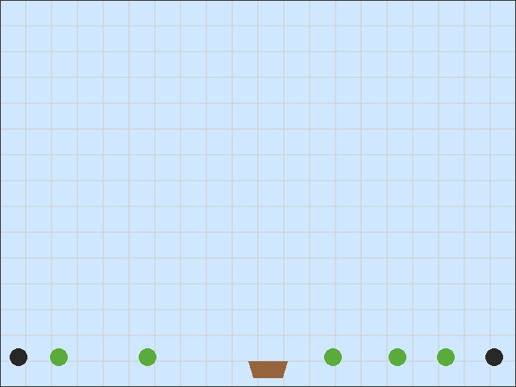
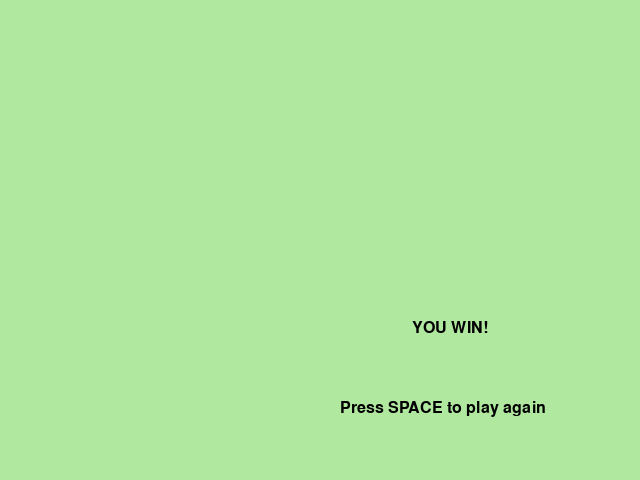

# PyGameMaker — Tutorial 16: Fruit Basket

## How to Use This Handout

This handout goes with the in-app tutorial **Help > Tutorials > Fruit Basket: Catch and Avoid!** (6 pages, about 10-15 minutes). Keep the tutorial open on one half of your screen. Tick each box when the step is done, and check the **You should see** line at the end of every phase. If something does not match, look at **Stuck?** before you call your teacher.

## What You Will Make

A basket that slides left and right along the bottom of the room. Fruit and bombs are already sitting in the room — nothing falls, nothing moves by itself. Walk the basket into a fruit and it disappears, adding to your score. Walk into a bomb and the room starts over. Collect every fruit and you win!

## Phase 1: Moving Basket

- [ ] **1.** Make a new project `FruitBasket`.
- [ ] **2.** Create a sprite `spr_basket` (56x40, a brown bowl shape) and an object `obj_player` with that sprite.
- [ ] **3.** Rename the project's starting room (`room0`) to `room_main`, set its **width to 640** and **height to 480** in its properties, and place `obj_player` near the bottom center.
- [ ] **4.** In `obj_player`: **Keyboard: Left Arrow (held)** with *Set horizontal speed to -5*; **Right Arrow (held)** with *5*; **Keyboard: No key** with *Stop movement*.

> DONE: **You should see:** press **F5**. Left and Right move the basket, and it stops when you let go.

## Phase 2: Fruit and Bombs

- [ ] **5.** Create a sprite `spr_fruit` (26x26, a green circle) and an object `obj_fruit` with that sprite. No events needed.
- [ ] **6.** Create a sprite `spr_bomb` (26x26, a dark circle) and an object `obj_bomb` with that sprite. No events needed here either.
- [ ] **7.** In `room_main`, place **5 fruit** along the bottom with gaps between them (but not right where the basket starts), and **2 bombs**, one near the left edge and one near the right edge, well away from any fruit.

> DONE: **You should see:** press **F5**. The fruit and bombs sit still. The basket can move among them, but touching them does nothing yet.

## Phase 3: Catching and Avoiding

- [ ] **8.** In `obj_player`, **Create** event: *Set score to 0*. **Draw** event: *Draw score at x 10, y 10*.
- [ ] **9.** Add **Collision with obj_fruit**: *Add 10 to score*, then *Destroy other instance* (the fruit, not the basket!).
- [ ] **10.** Add **Collision with obj_bomb**: *Restart Room*.

> DONE: **You should see:** press **F5**. Catching a fruit adds 10 to the score and the fruit disappears. Touching a bomb puts everything back where it started, score included.

## Phase 4: Winning

- [ ] **11.** Create `obj_win_text`. **Draw** event: *Draw text* "YOU WIN!" at x 412, y 320 and "Press SPACE to play again" at x 340, y 400. **Key press: space**: *Restart game*.
- [ ] **12.** Create `room_win` with a bright background color, and place one `obj_win_text` in it.
- [ ] **13.** In `obj_player`, add a **Step** event: *If count of* `obj_fruit` *equals 0* then *Go to room* `room_win`.

> DONE: **You should see:** press **F5**. Collect every fruit and the YOU WIN! room appears. SPACE starts a new game.

## Bonus (optional): Import Ready-Made Art

Page 6 of the tutorial shows how to swap any of your drawings for ready-made
pictures instead, if you'd rather not draw. Your game works exactly the same
either way — this is only worth doing once everything above already works.

## Stuck?

| What is wrong | Most likely cause | What to do |
| The basket catches a fruit the instant the game starts | A fruit was placed too close to the basket's own starting spot | Move that fruit further away, or move the basket's start position |
| My basket disappears when it catches a fruit | I used *Destroy this instance* | Use **Destroy other instance** |
| Touching a bomb does nothing | No **Collision with obj_bomb** on `obj_player`, or it uses the wrong action | Add the collision and use **Restart Room** |
| The score does not show | No **Draw** event on the basket | Add *Draw score* to a Draw event |
| The game says YOU WIN! at once | There is no fruit in `room_main` (the count is already 0) | Place at least one fruit in the room |
| I catch every fruit but nothing happens | The Step event or the room name is wrong | Check *If count of obj_fruit equals 0* and the room name `room_win` |
| The win screen is blank | `obj_win_text` was not placed in `room_win`, or its Draw event is missing | Place one instance; check the Draw event exists |
| SPACE does nothing on the win screen | The win room has no object with a **Key press: space** event | Add the event to `obj_win_text` |

## Challenges

- **Try this (5 minutes):** add a few more fruit, or move the bombs closer together.
- **Push further:** add a second row of fruit higher up (you'll need to let the basket move up and down too, or add a ladder-like object).
- **Invent:** give fruit different point values by making a second fruit object worth more.

## Vocabulary

| Term | What it means |
| Collision | An event that fires the moment two objects touch |
| Instance count | How many copies of an object exist right now |
| Restart Room | An action that puts the current room back exactly how it started |
| Step event | An event that runs every single frame of the game, over and over |

## Check Yourself

Write your answers in the notes below.

1. Why does the fruit never need its own events, unlike the basket?
2. What happens to your score if you touch a bomb? Why?
3. How does the game know when you've collected every fruit?

## My Notes

[[notes:10]]
