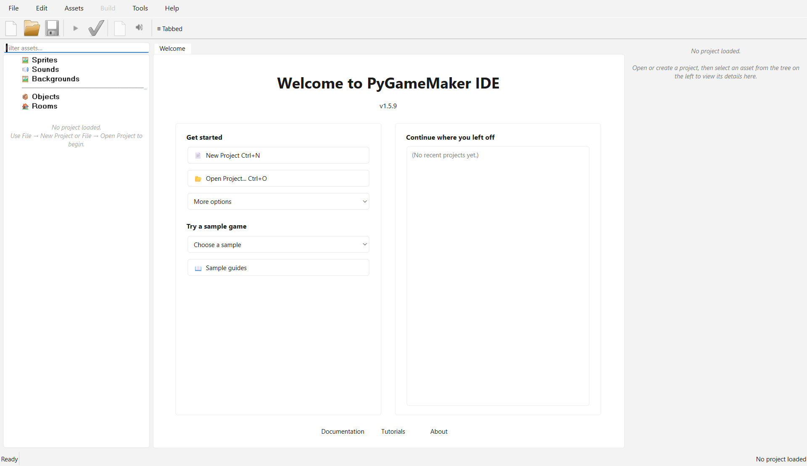
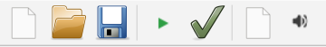
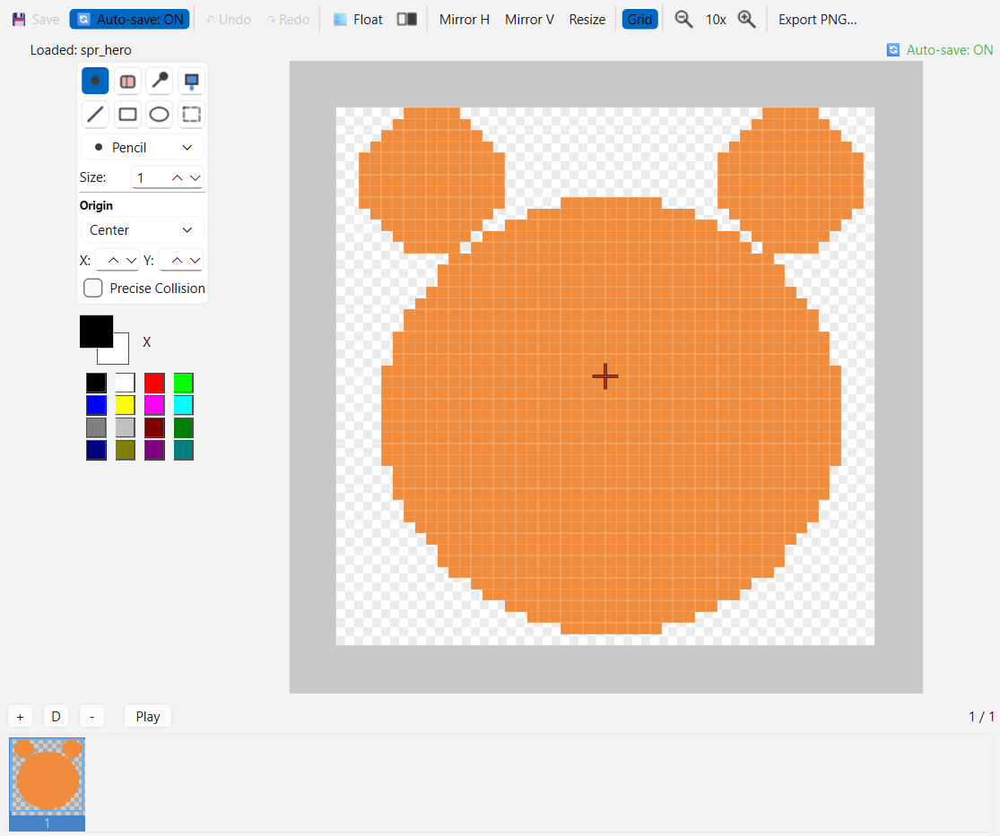
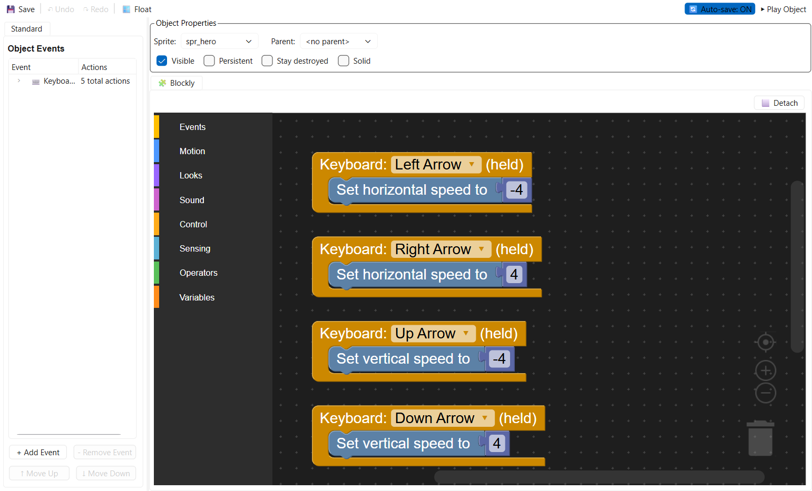
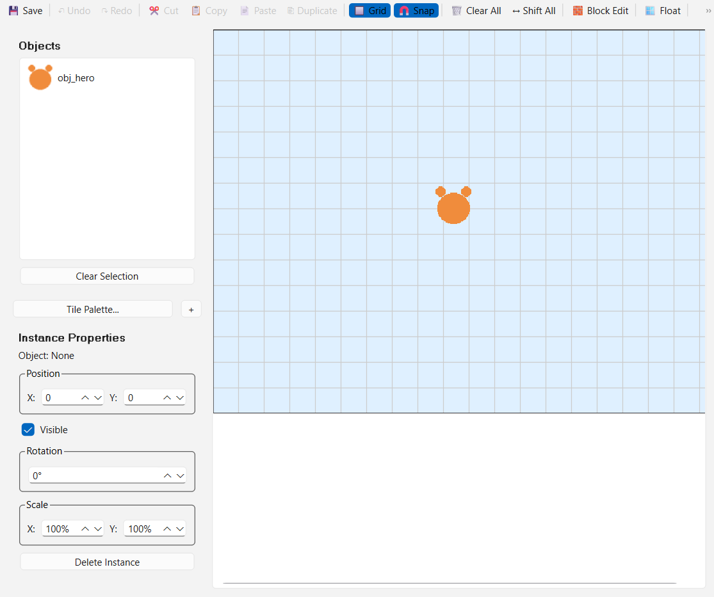
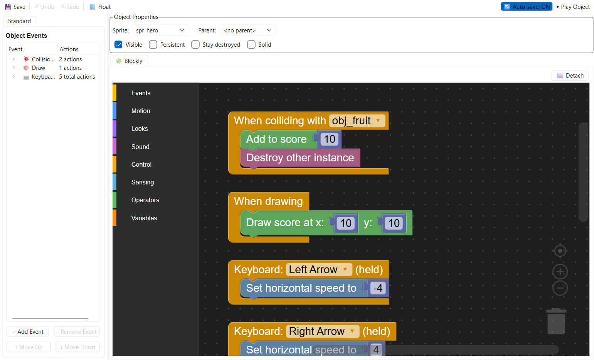
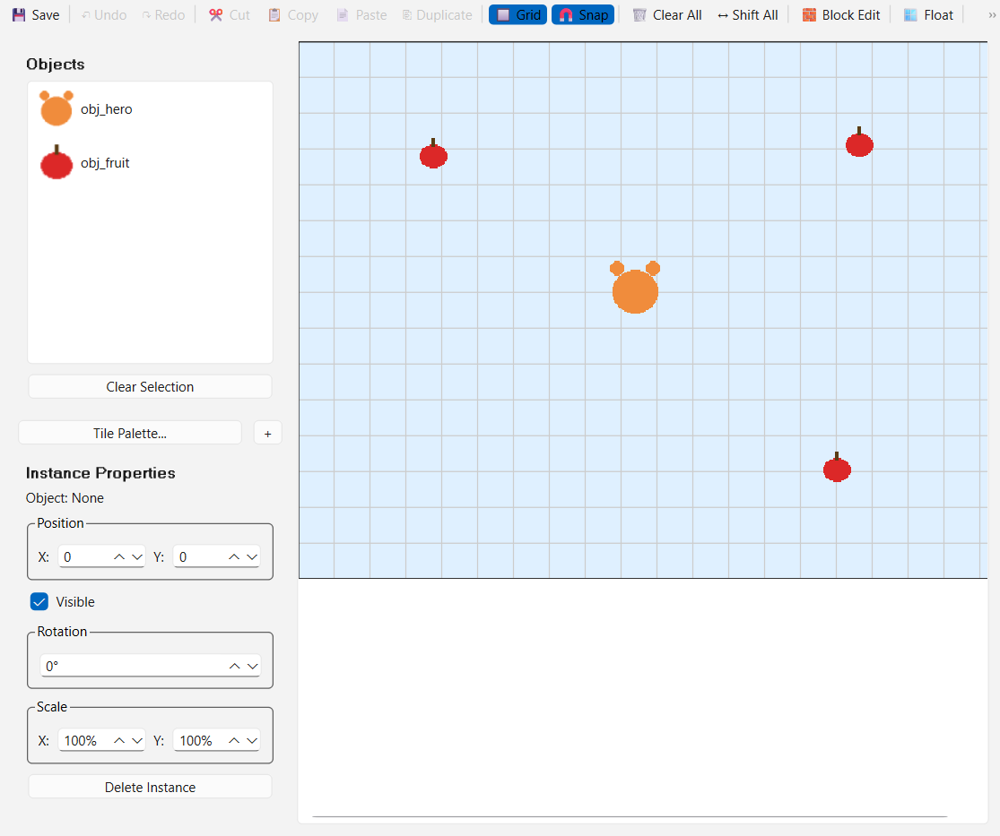

# PyGameMaker Junior: Make Your Own Game

Keep this sheet next to your computer. Do each part, then tick the box.
Stuck? Ask a neighbour first, then your teacher.

## Part 1: Start a Project

When the program starts, you see this:

- [ ] Click **New Project**.
- [ ] Give your project a name, for example `MyGame`.
- [ ] Click **OK**.

## Part 2: Your Tools

Look at the top of the window:

- **New**: start a game
- **Open**: open a game you saved
- **Save**: save your game. Do this often!
- **Green triangle**: play your game (or press **F5**)
- **Green tick**: share your game

On the left you have your **resources**: sprites, objects and rooms.

- A **sprite** is a picture.
- An **object** does things in your game.
- A **room** is a level (a screen of your game).

## Part 3: Draw a Sprite

- [ ] Click **Assets > Create Sprite**.
- [ ] Give it a name, for example `spr_hero`.
- [ ] Choose a colour and draw with the pencil.
- [ ] Click **Save**.

> TIP: Start the names of your sprites with `spr_`.

## Part 4: Make an Object Move in 4 Directions

- [ ] Click **Assets > Create Object** and name it `obj_hero`.
- [ ] In **Sprite**, choose your sprite.
- [ ] Add 4 **Keyboard** blocks (Left Arrow, Right Arrow, Up Arrow, Down
      Arrow). In each one, put **Set horizontal speed** or **Set vertical
      speed to**: left -4, right 4, up -4, down 4.
- [ ] Add **Keyboard: No key**, then **Stop movement**, so your hero stops
      when you touch nothing.

> TIP: Right-click a block to duplicate or delete it. Duplicate the **Left
> Arrow** block three times, then just change the key and the number in each
> copy!

## Part 5: Build a Room and Play

Your project already has a room, **room0**. You do not need to create one!

- [ ] Double-click **room0** in the **Rooms** list on the left.
- [ ] Click your object in the list, then click in the room to place it.

- [ ] Press the **green triangle** (or **F5**) to play.

> TIP: You can rename **room0** if you want (right-click > Rename).

> DONE: You see your sprite in the game and you can make it move.

## Part 6: Share Your Game

- [ ] Click **File > Export as HTML5**.
- [ ] Choose a folder.
- [ ] Click **Yes** to open it in your browser.

You get a file ending in `.html`. Send it to a friend: they can play it!

## Part 7: BONUS: Pick Up Fruit!

Your game already works. If you still have time, add points!

- [ ] Create a sprite `spr_fruit` (a small red or yellow circle).
- [ ] Create an object `obj_fruit` with this sprite.
- [ ] Open **obj_hero** and add the event **When colliding with obj_fruit**.
- [ ] Put 2 blocks in it: **Add to score 10** and **Destroy other instance**.
- [ ] Add the event **When drawing**, with the block **Draw score at x: 10
      y: 10**.

- [ ] Go back to **room0** and place 2 or 3 `obj_fruit` in the room.

- [ ] Press **F5**: pick up the fruit to win points!

> DONE: Your score goes up and the fruit disappears when you touch it.

## Stuck?

| What happens | Try this |
|---|---|
| My object does not move | Is there a block under **Keyboard**? Is the object in the room? |
| My hero never stops | Add **Keyboard: No key** + **Stop movement** |
| I cannot see my sprite | Did you choose the sprite in the **Sprite** box? |
| I deleted something by mistake | **Tools > Restore Deleted Assets** |
| The game shows a grey window | Wait a little, then try again |
| My score does not go up | Is the collision event on **obj_hero**, with the right object chosen? |

## Words to Know

- **Sprite**: a picture
- **Object**: a thing that does actions
- **Room**: a level (a screen of your game)
- **Block**: a piece of your program
- **Collision**: when two objects touch
- **Score**: your points

## Challenges

- **Try this:** change the colour of your fruit, or how many points it is worth.
- **Push further:** add a second kind of fruit that is worth more points.

## Think About It

1. What is the **Keyboard** block for?
2. What is the difference between a sprite and an object?

## My Notes

[[notes:6]]
