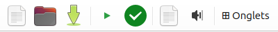
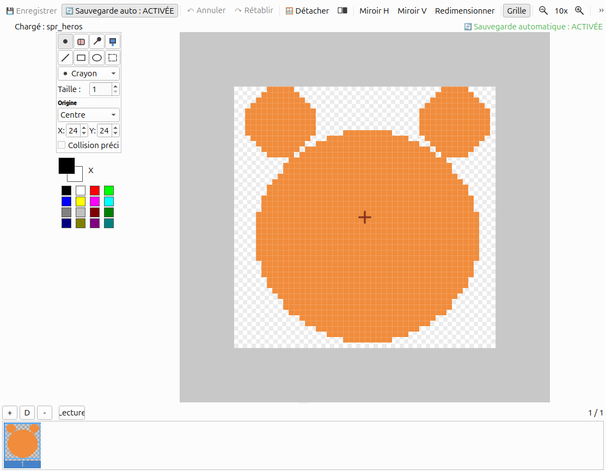
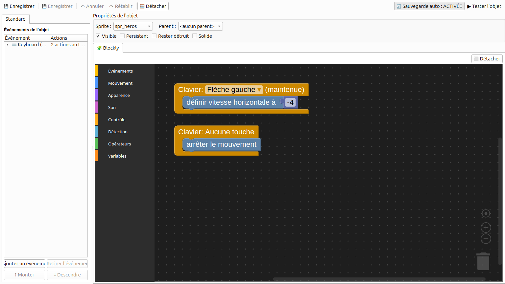
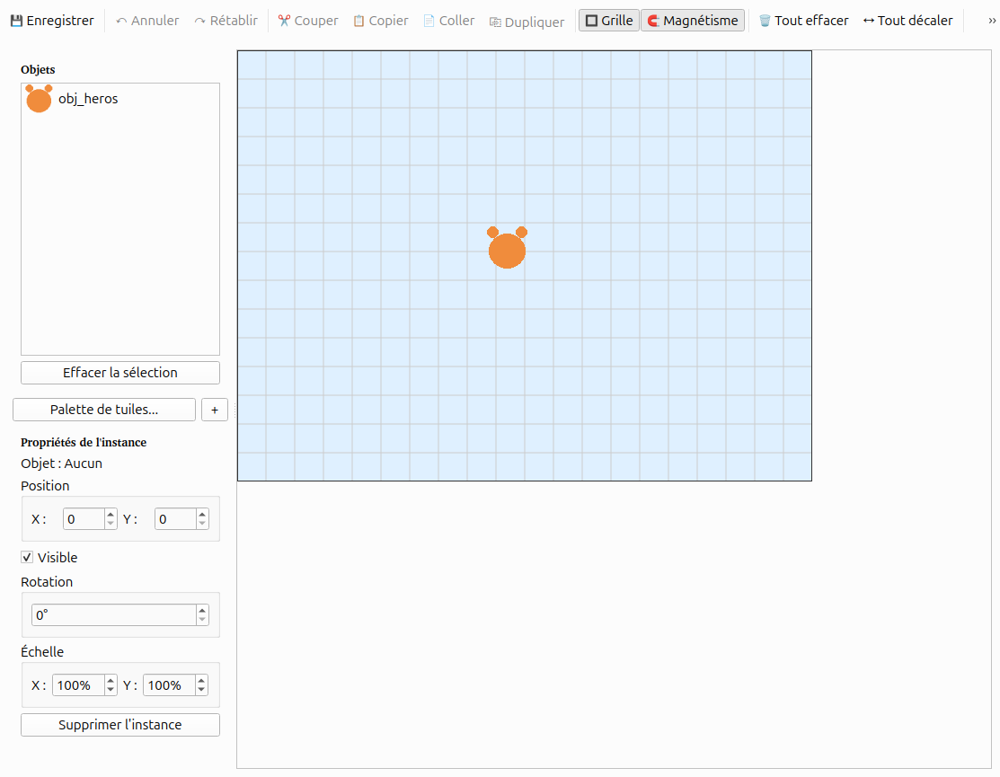

# PyGameMaker Junior : crée ton propre jeu

Garde cette feuille à côté de toi. Fais chaque partie, puis coche la case.
Bloqué ? Demande à un copain, puis à ton enseignant.

## Partie 1 : commence un projet

Au démarrage, tu vois ça :

- [ ] Clique **Nouveau projet**.
- [ ] Donne un nom à ton projet, par exemple `MonJeu`.
- [ ] Clique **OK**.

## Partie 2 : tes outils

Regarde en haut de la fenêtre :

- **Nouveau** : commencer un jeu
- **Ouvrir** : reprendre un jeu
- **Enregistrer** : sauver ton jeu. Fais-le souvent !
- **Triangle vert** : jouer (ou touche **F5**)
- **Coche verte** : partager ton jeu

À gauche, tu as tes **ressources** : sprites, objets, salles.

- Un **sprite** est une image.
- Un **objet** fait des choses dans ton jeu.
- Une **salle** est un niveau.

## Partie 3 : dessiner un sprite

- [ ] Clique **Ressources > Créer un sprite**.
- [ ] Donne-lui un nom, par exemple `spr_heros`.
- [ ] Choisis une couleur et dessine avec le crayon.
- [ ] Clique **Enregistrer**.

> TIP : commence les noms de sprites par `spr_`.

## Partie 4 : faire bouger un objet

- [ ] Clique **Ressources > Créer un objet**, nomme-le `obj_heros`.
- [ ] Dans **Sprite**, choisis ton sprite.
- [ ] Glisse des blocs : **Clavier: Flèche gauche** puis
      **définir vitesse horizontale à**.
- [ ] Ajoute **Clavier: Aucune touche** puis **arrêter le mouvement**.

> TIP : clic droit sur un bloc pour le dupliquer ou le supprimer.

## Partie 5 : construire une salle et jouer

- [ ] Clique **Ressources > Créer une salle**.
- [ ] Clique sur ton objet dans la liste, puis clique dans la salle pour le
      placer.

- [ ] Appuie sur le **triangle vert** (ou **F5**) pour jouer.

> DONE : tu vois ton sprite dans le jeu et tu peux le faire bouger.

## Partie 6 : partager ton jeu

- [ ] Clique **Fichier > Exporter en HTML5**.
- [ ] Choisis un dossier.
- [ ] Clique **Oui** pour l'ouvrir dans ton navigateur.

Tu obtiens un fichier `.html`. Envoie-le à un ami : il peut y jouer !

## Tu es bloqué ?

| Ce qui se passe | Essaie ceci |
|---|---|
| Mon objet ne bouge pas | Un bloc est-il sous **Clavier** ? L'objet est-il dans la salle ? |
| Mon héros ne s'arrête jamais | Ajoute **Clavier: Aucune touche** + **arrêter le mouvement** |
| Je ne vois pas mon sprite | As-tu choisi le sprite dans la case **Sprite** ? |
| J'ai supprimé un truc par erreur | **Outils > Restaurer les ressources supprimées** |
| Le jeu affiche une fenêtre grise | Attends un peu, puis réessaie |

## Mots à connaître

- **Sprite** : une image
- **Objet** : une chose qui fait des actions
- **Salle** : un niveau
- **Bloc** : un morceau de ton programme

## Défis

- **Essaie (5 min) :** dessine un deuxième sprite et crée un deuxième objet.
- **Va plus loin :** fais aussi bouger ton héros vers le haut et vers le bas.

## Réfléchis

1. À quoi sert le bloc **Clavier** ?
2. Quelle est la différence entre un sprite et un objet ?

## Mes notes

[[notes:6]]
