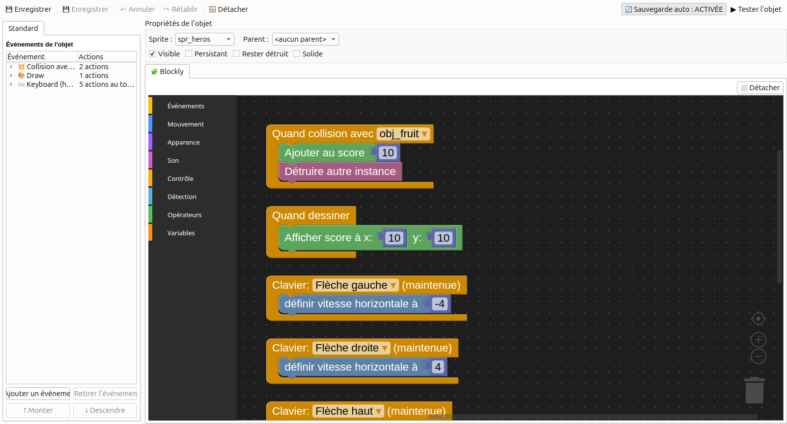
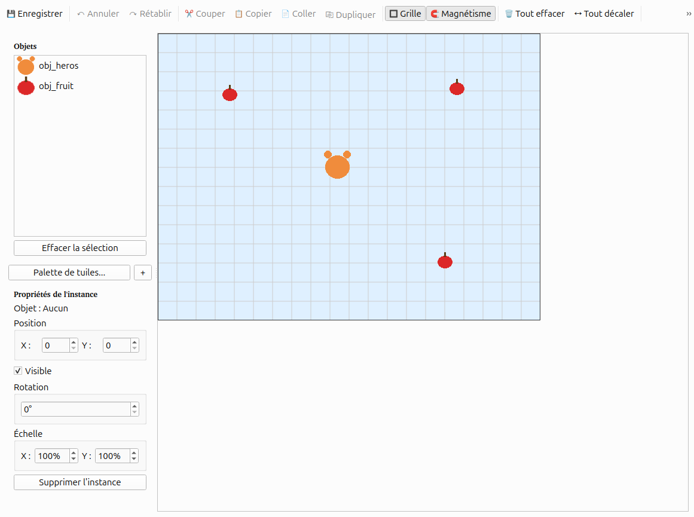

# PyGameMaker Junior : crée ton propre jeu

Garde cette feuille à côté de toi. Fais chaque partie, puis coche la case.
Bloqué ? Demande à un copain, puis à ton enseignant.

## Partie 1 : commence un projet

Au démarrage, tu vois ça :

- [ ] Clique **Nouveau projet**.
- [ ] Donne un nom à ton projet, par exemple `MonJeu`.
- [ ] Clique **OK**.

## Partie 2 : tes outils

Regarde en haut de la fenêtre :

- **Nouveau** : commencer un jeu
- **Ouvrir** : reprendre un jeu
- **Enregistrer** : sauver ton jeu. Fais-le souvent !
- **Triangle vert** : jouer (ou touche **F5**)
- **Coche verte** : partager ton jeu

À gauche, tu as tes **ressources** : sprites, objets, salles.

- Un **sprite** est une image.
- Un **objet** fait des choses dans ton jeu.
- Un **room** est une salle (un niveau).

## Partie 3 : dessiner un sprite

- [ ] Clique **Ressources > Créer un sprite**.
- [ ] Donne-lui un nom, par exemple `spr_heros`.
- [ ] Choisis une couleur et dessine avec le crayon.
- [ ] Clique **Enregistrer**.

> TIP : commence les noms de sprites par `spr_`.

## Partie 4 : faire bouger un objet dans les 4 directions

- [ ] Clique **Ressources > Créer un objet**, nomme-le `obj_heros`.
- [ ] Dans **Sprite**, choisis ton sprite.
- [ ] Ajoute 4 blocs **Clavier** (Flèche gauche, droite, haut, bas), chacun
      avec **définir vitesse horizontale et vitesse verticale à** : gauche -4,
      droite 4, haut -4, bas 4.
- [ ] Ajoute **Clavier: Aucune touche** puis **arrêter le mouvement**, pour
      que ton héros s'arrête quand tu ne touches rien.

> TIP : clic droit sur un bloc pour le dupliquer ou le supprimer. Duplique
> le bloc **Flèche gauche** trois fois, puis change juste la touche et le
> nombre dans chaque copie !

## Partie 5 : construire une salle et jouer

Ton projet a déjà une salle, **room0**. Pas besoin d'en créer une !

- [ ] Double-clique sur **room0** dans la liste **Rooms**, à gauche.
- [ ] Clique sur ton objet dans la liste, puis clique dans la salle pour le
      placer.

- [ ] Appuie sur le **triangle vert** (ou **F5**) pour jouer.

> TIP : tu peux renommer **room0** si tu veux (clic droit > Renommer).

> DONE : tu vois ton sprite dans le jeu et tu peux le faire bouger.

## Partie 6 : partager ton jeu

- [ ] Clique **Fichier > Exporter en HTML5**.
- [ ] Choisis un dossier.
- [ ] Clique **Oui** pour l'ouvrir dans ton navigateur.

Tu obtiens un fichier `.html`. Envoie-le à un ami : il peut y jouer !

## Partie 7 : BONUS — ramasse des fruits !

Ton jeu marche déjà. Si tu as encore du temps, ajoute des points !

- [ ] Crée un sprite `spr_fruit` (un petit rond rouge ou jaune).
- [ ] Crée un objet `obj_fruit` avec ce sprite.
- [ ] Ouvre **obj_heros**, ajoute l'événement **Quand collision avec
      obj_fruit**.
- [ ] Mets-y 2 blocs : **Ajouter au score 10** et **Détruire autre
      instance**.
- [ ] Ajoute l'événement **Quand dessiner**, avec le bloc **Afficher score
      à x: 10 y: 10**.

- [ ] Retourne dans **room0** et place 2 ou 3 `obj_fruit` dans la salle.

- [ ] Appuie sur **F5** : ramasse les fruits pour gagner des points !

> DONE : ton score augmente et le fruit disparaît quand tu le touches.

## Tu es bloqué ?

| Ce qui se passe | Essaie ceci |
|---|---|
| Mon objet ne bouge pas | Un bloc est-il sous **Clavier** ? L'objet est-il dans la salle ? |
| Mon héros ne s'arrête jamais | Ajoute **Clavier: Aucune touche** + **arrêter le mouvement** |
| Je ne vois pas mon sprite | As-tu choisi le sprite dans la case **Sprite** ? |
| J'ai supprimé un truc par erreur | **Outils > Restaurer les ressources supprimées** |
| Le jeu affiche une fenêtre grise | Attends un peu, puis réessaie |
| Mon score n'augmente pas | L'événement collision est-il sur **obj_heros**, avec le bon objet choisi ? |

## Mots à connaître

- **Sprite** : une image
- **Objet** : une chose qui fait des actions
- **Room** : une salle (un niveau)
- **Bloc** : un morceau de ton programme
- **Collision** : quand deux objets se touchent
- **Score** : tes points

## Défis

- **Essaie :** change la couleur ou le nombre de points de ton fruit.
- **Va plus loin :** ajoute un deuxième type de fruit qui vaut plus de points.

## Réfléchis

1. À quoi sert le bloc **Clavier** ?
2. Quelle est la différence entre un sprite et un objet ?

## Mes notes

[[notes:6]]
