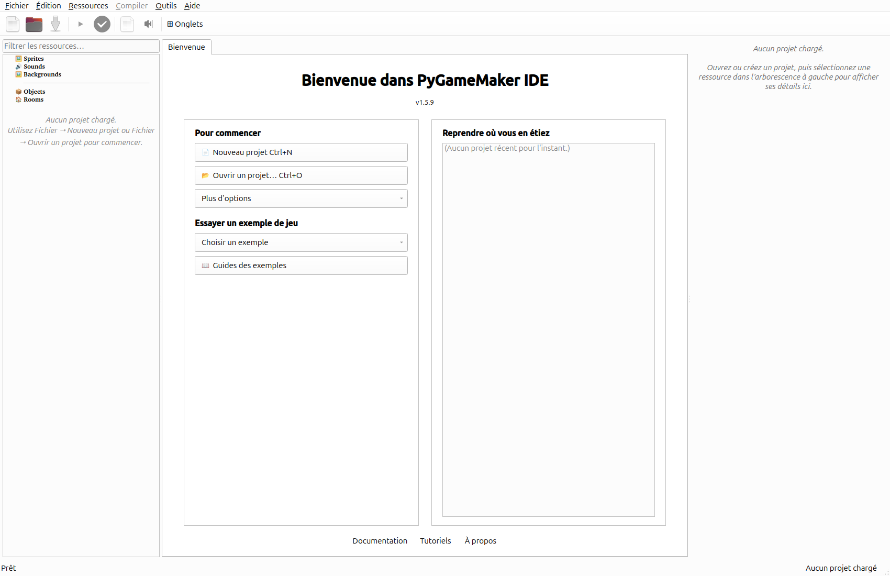

# Découvre PyGameMaker !

Voici à quoi ressemble l'écran de PyGameMaker. Regarde bien chaque partie !

- **Barre des menus** : Fichier, Ressources, Compiler, Aide...
- **Barre d'icônes** : les boutons pour commencer, enregistrer, jouer
- **Ressources** (à gauche) : tes sprites, sons, objets et salles
- **Zone d'édition** (au centre) : là où tu construis ton jeu
- **Propriétés** (à droite) : les réglages de ce que tu as choisi

> TIP: Appuie sur le triangle vert ▶ (ou la touche F5) pour jouer à ton jeu !
