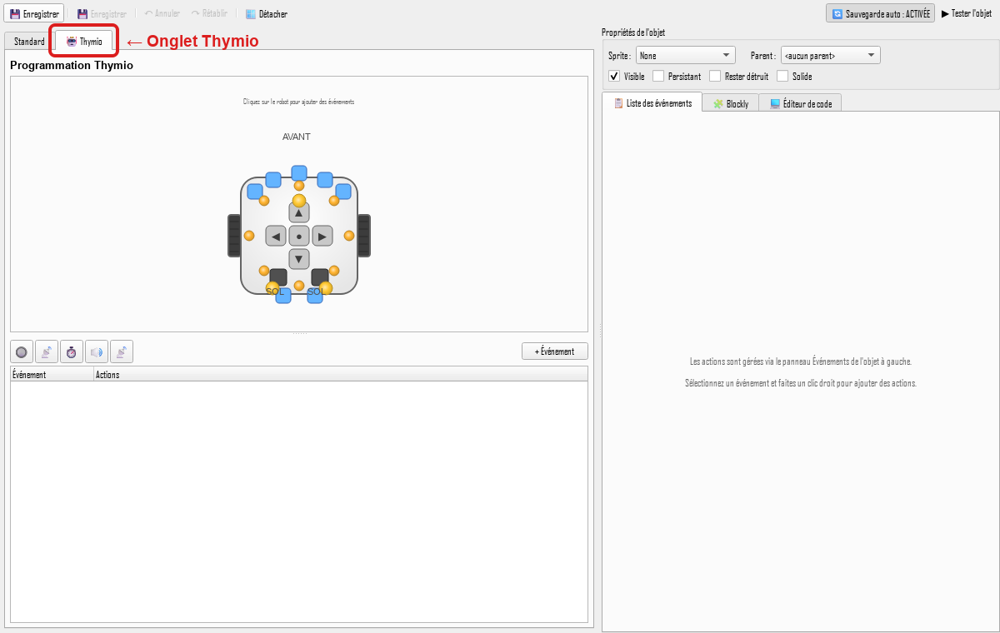

# Fiche 1 : Découvrir le simulateur

**Exemple à ouvrir :** Thymio — Activités : arène libre  ·  **Durée :** 20 minutes

## Ce que tu vas apprendre

- reconnaître les parties du robot Thymio ;
- utiliser un **événement** (« quand… ») et une **action** (« fais… ») ;
- allumer une LED avec un bouton.

## 1. Regarde le robot

Lance **Test Game**. Au centre de la pièce, tu vois le robot vu de dessus :

- en haut : les **5 boutons** (avant, arrière, gauche, droite et le rond du centre) ;
- autour du centre : un **cercle de 8 LED** ;
- au centre : la **LED du dessus** ; en dessous, deux petites LED, **bas gauche** et **bas droite**.

- [ ] Appuie sur **↑**, **↓**, **←**, **→** et sur la **barre d'espace**. Que se passe-t-il ? (Rien : le robot n'a pas encore de programme.)
- [ ] Clique avec la souris sur un bouton dessiné sur le robot. C'est la même chose que le clavier.

## 2. Ton premier programme

Ferme le jeu, ouvre l'objet **thymio_1** et va dans l'onglet **Thymio**.

- [ ] Clique sur **+ Événement** et choisis **Bouton avant**.
- [ ] Clic droit sur l'événement → **Ajouter une action** → **LED** → **Régler la LED du dessus**. Mets **Rouge = 0**, **Vert = 32**, **Bleu = 0**.
- [ ] Lance **Test Game** et appuie sur **↑** : la LED du dessus devient verte.

> INFO: pour chaque LED, une couleur est composée de trois nombres de **0** (éteint) à **32** (maximum). La fiche 2 explique le mélange.

## 3. À toi de jouer

Ajoute les événements suivants :

| Événement | Action à ajouter |
|---|---|
| **Bouton arrière** | **Régler la LED du dessus** : rouge (32, 0, 0) |
| **Bouton gauche** | **Régler la LED en bas à gauche** : bleu (0, 0, 32) |
| **Bouton droit** | **Régler la LED en bas à droite** : bleu (0, 0, 32) |
| **Bouton central** | **Éteindre les LED** |

- [ ] Teste chaque bouton. Quel bouton éteint tout ?
- [ ] Appuie sur **←** puis sur **→** : les deux LED du bas sont-elles allumées en même temps ?

> DONE: tu sais associer un événement à une action. C'est la base de tout programme Thymio.

## Pour aller plus loin

- Fais que **Bouton central** allume la LED du dessus en blanc (32, 32, 32).
- Fais que **Bouton gauche** allume **aussi** la LED du dessus : ajoute deux actions au même événement.
